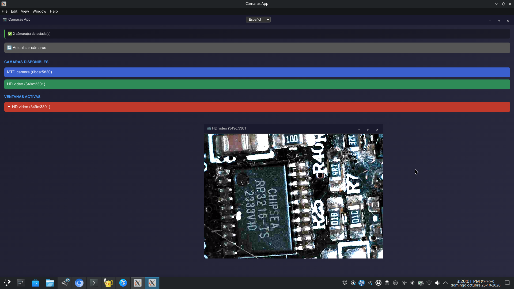

[README English](https://github.com/adga137/multi-cam-app/blob/main/README.md) , [README Spanish](https://github.com/adga137/multi-cam-app/blob/main/README-ES.md) ,  [README Brazilian Portuguese](https://github.com/adga137/multi-cam-app/blob/main/README-PT-BR.md)

# 📷 Camera App (Multi-Cam Desktop)

A cross-platform desktop application built with **Electron** that allows for the management of multiple webcams in independent, borderless windows. It features controls for zoom, cropping, panning, and flash (torch) activation—provided the hardware supports it. The application includes multi-language support and a clean, optimized interface.



---

## 🤝 Credits and Development

This project is the result of a collaboration between artificial intelligence and human development:

- **Core Development and Architecture**: Developed by **Qwen3.7** (an AI model from Alibaba Cloud).
- **Co-developer and Fine-tuning**: Alejandro García (GitHub: **adga137**) – responsible for oversight, UI/UX fine-tuning, hardware testing, and visual optimization.

---

## ⚖️ Licence

This software is protected under the **GNU General Public License v3.0 (GPLv3)**.
This means that you are free to use, modify, and distribute the software, provided that any derivative work is distributed under the same license and the code remains open source.
See the `LICENSE` file for further details, or visit: [https://www.gnu.org/licenses/gpl-3.0.html](https://www.gnu.org/licenses/gpl-3.0.html)

---

## ☕ Support Development

If you find this application useful and would like to support its maintenance, bug fixes, and the development of new features in the future, you can make a donation through the following channels:

- **Binance ID**: `[60122342]`
- **Bitcoin (BTC)**: `[1PFp17P2fHH1kwywHsuR84XDU9jZfXR6gU]`
- **Litecoin (LTC)**: `[LRqgbivRfHTqk3S2iU5QKN5Hsfnqufzikj]`

*Any contribution, however small, is deeply appreciated and goes directly toward the continuous improvement of the project.*

---

## 🚀 Key Features

- 🪟 **Independent Windows**: Each camera opens in a native operating system window without a title bar (`frame: false`).
- 💡 **Flash/Torch Support**: A dedicated button to activate the camera light (automatically hidden if the hardware does not support it).
- 🔍 **Image Controls**: Real-time digital zoom, cropping, and panning (image movement).
- 🌍 **Multi-language**: Native support for Spanish, English, and Portuguese (easily extensible), with user preference persistence.
- 🖥️ **Multi-platform**: Compilable for Windows, macOS, and Linux.

---

## 📦 Installation and Configuration

1. Clone this repository to your local machine:
```bash
git clone https://github.com/YOUR_USERNAME/camaras-app.git
cd camaras-app
```

2. Install the project dependencies:

```bash
npm install
```
3. (Optional but recommended): Place a custom 512x512-pixel PNG icon file named `icon.png` inside the `assets/` folder.

---

## 💻 Running in Development Mode

To test the application in real-time with developer tools (DevTools) enabled:

```bash
npm run dev
```

Or simply use **npm start** to run it without the developer tools.

---

## 🏗️ Building and Distribution

The project uses `electron-builder` to package the application into native installers. Ensure that you run these commands on the operating system for which you intend to build (e.g., building for macOS requires being on a Mac).

---

### Build for all platforms (if on macOS)

```bash
npm run build:all
```

### Build for Windows only (.exe / NSIS)

```bash
npm run build:win
```

The installer will be generated in the `dist/` folder.

### Build for macOS only (.dmg)

```bash
npm run build:mac
```

**Note:** To distribute publicly on macOS, you will need to configure Apple certificates and notarization in `package.json`.
Build for Linux only (.AppImage and .deb)

---

## 📂 Project Structure

```text
camaras-app/
├── assets/                 # Icons and static assets
├── .github/                # GitHub Actions workflows (CI/CD)
├── main.js                 # Electron main process
├── preload.js              # Secure bridge between backend and frontend
├── index.html              # Main window interface
├── camera-window.html      # Camera window interface
├── renderer.js             # Main window logic
├── camera-renderer.js      # Camera window logic (WebRTC, controls)
├── i18n.js                 # Translation and localization system
├── styles.css              # Global stylesheet
└── package.json            # Project and electron-builder configuration
```

---

## ⚠️ Important Notes

- Camera Permissions: The first time you run the app, the operating system (especially on macOS and Windows 11) will request permission to access the camera. You must grant this permission.
- Wayland on Linux: If you are using a Linux distribution with Wayland, ensure that the PipeWire environment variables are enabled for WebRTC capture (this is already included in the flags within `main.js`).
- Flash/Torch: The flash feature will only appear if the browser API detects "torch" capability in the camera's video track.

---

## 📬 Contact and Contributions

Contributions, bug reports, and feature requests are welcome. Please open an Issue or a Pull Request in this repository.
Thank you for using Cámaras App!
